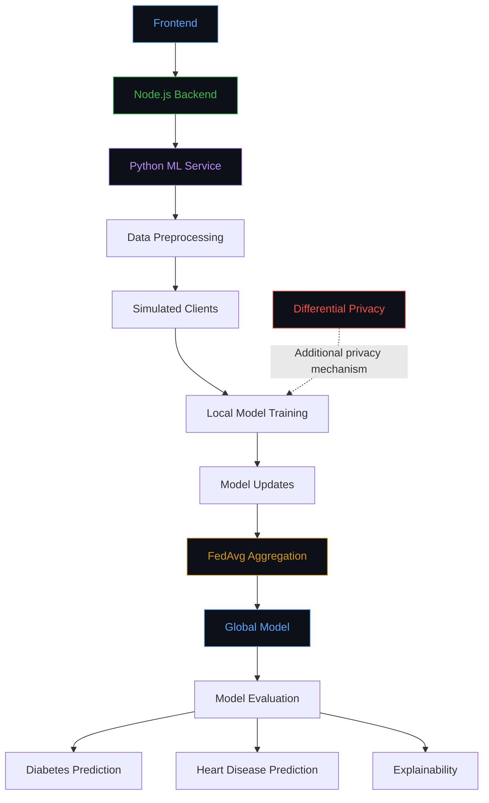

<div align="center">


<br>

<a href="https://www.python.org/">

</a>
<a href="https://nodejs.org/">

</a>
<a href="https://react.dev/">

</a>
<a href="https://scikit-learn.org/">

</a>

<br><br>


<br>


<br>

*Intelligent predictions. Distributed learning. Privacy by design.*

</div>

---

##  &nbsp; Project Overview

Healthcare data can help machine learning models identify patterns associated with diseases. However, centralizing sensitive medical records creates privacy, security, and data-governance challenges.

**Privacy-Preserving Disease Prediction System** is an academic project exploring how machine learning can predict disease risk while reducing the need to centralize raw training data.

The proposed system combines three approaches:

- **Federated Learning** — training across distributed clients.
- **Differential Privacy** — limiting information leakage through appropriately designed privacy mechanisms.
- **Explainable AI** — making model behavior easier to interpret.

### Target Applications

| Application | Objective |
|:---|:---|
| Diabetes Prediction | Explore disease classification using relevant healthcare features. |
| Heart Disease Prediction | Explore cardiovascular disease classification using suitable health indicators. |

> **Vision:** Explore how machine learning can support healthcare research while taking patient privacy seriously.

---

##  &nbsp; Problem Statement

Traditional centralized machine learning collects training data in one location. In healthcare, this can create challenges:

- Sensitive medical records require strong protection.
- Institutions may be unable to share raw patient data.
- Centralized data collection can increase exposure risks.
- Complex models may be difficult to interpret.
- Biased datasets can produce unreliable predictions.

### Proposed Approach

Develop a prototype that explores decentralized training, disease prediction, additional privacy protection, and model explainability.

The system will investigate the relationship between predictive performance, privacy protection, and interpretability.

---

##  &nbsp; Core Components

<table>
<tr>
<td width="50%" valign="top">

<h3>

&nbsp; Machine Learning
</h3>

Develop baseline prediction models.

- Dataset preprocessing
- Feature selection
- Classification
- Model evaluation

</td>
<td width="50%" valign="top">

<h3>

&nbsp; Federated Learning
</h3>

Explore decentralized training.

- Simulated clients
- Local model training
- Model-update exchange
- FedAvg aggregation

</td>
</tr>
<tr>
<td width="50%" valign="top">

<h3>

&nbsp; Differential Privacy
</h3>

Investigate additional privacy protection.

- Privacy mechanisms
- Noise addition
- Privacy accounting
- Utility evaluation

</td>
<td width="50%" valign="top">

<h3>

&nbsp; Explainable AI
</h3>

Explore model interpretability.

- Feature importance
- Prediction explanations
- Model behavior analysis
- Interpretability evaluation

</td>
</tr>
</table>

*These components describe the proposed system. Their implementation status will be updated as development progresses.*

---

##  &nbsp; System Architecture

The following diagram illustrates the proposed architecture.



*Proposed design; update it to reflect the implemented system.*

### Workflow

| Stage | Description |
|:---|:---|
| 01 — Data Preparation | Clean and prepare the healthcare dataset. |
| 02 — Client Distribution | Divide training data among simulated clients. |
| 03 — Local Training | Train a compatible model on each client's local data. |
| 04 — Aggregation | Combine compatible model updates using FedAvg. |
| 05 — Global Model | Distribute the aggregated model for further training. |
| 06 — Evaluation | Measure performance using suitable metrics. |
| 07 — Explainability | Investigate which features influence predictions. |

### Privacy Consideration

Federated Learning reduces the need to centralize raw training data, but model updates can still leak information. Differential Privacy and other security mechanisms must be implemented and evaluated separately.

---

##  &nbsp; Technology Stack

<div align="center">

| Technology | Purpose |
|:---|:---|
| Python | ML and federated training |
| Node.js | Backend runtime |
| Express.js, if used | API and request handling |
| React or existing frontend framework | User interface |
| Pandas | Data preprocessing |
| NumPy | Numerical computing |
| Scikit-learn | Classical ML algorithms |
| Flower | Federated Learning framework under consideration |
| SHAP | Explainability framework under consideration |
| Git & GitHub | Version control |

</div>

*Adjust this table to include only the technologies actually used or planned for the project.*

---

##  &nbsp; Project Structure

The repository currently follows a frontend/backend organization. The following is a proposed extension for the Python ML components.

```text
privacy-preserving-disease-prediction/
│
├── frontend/
│   ├── src/
│   │   ├── components/
│   │   ├── pages/
│   │   └── assets/
│   └── package.json
│
├── backend/
│   ├── routes/
│   ├── controllers/
│   ├── middleware/
│   ├── services/
│   ├── server.js
│   └── package.json
│
├── ml-service/
│   ├── datasets/
│   ├── models/
│   ├── federated_learning/
│   │   ├── client.py
│   │   ├── server.py
│   │   └── strategy.py
│   ├── train_model.py
│   ├── predict.py
│   └── requirements.txt
│
├── .gitignore
└── README.md
```

**Note:** This is an illustrative structure, not a requirement to reorganize your existing project. Create `ml-service/` only if you choose to keep the Python ML code separate from the Node.js backend.

---

##  &nbsp; Getting Started

### Prerequisites

- Node.js and npm
- Python
- Git
- A code editor

### 01 — Clone the Repository

```bash
git clone https://github.com/YOUR_USERNAME/YOUR_REPOSITORY.git
cd YOUR_REPOSITORY
```

Replace the placeholders with your actual repository details.

### 02 — Install Frontend Dependencies

```bash
cd frontend
npm install
```

### 03 — Install Backend Dependencies

From the repository root:

```bash
cd backend
npm install
```

### 04 — Set Up the Python Environment

If the separate Python service exists:

```bash
cd ml-service
python3 -m venv .venv
source .venv/bin/activate
```

Install the dependencies listed in `requirements.txt`:

```bash
pip install -r requirements.txt
```

### 05 — Run the Application

Use the scripts in your actual `package.json` files to start the frontend and backend.

If the Python ML service is implemented separately, start it according to its own execution instructions.

*These commands are templates; the actual run commands depend on your current project configuration.*

---

##  &nbsp; Model Evaluation

The project will evaluate prediction performance using multiple metrics.

| Metric | Purpose |
|:---|:---|
| Accuracy | Overall proportion of correct predictions |
| Precision | Reliability of positive predictions |
| Recall | Ability to identify positive cases |
| F1-score | Balance between precision and recall |
| Confusion Matrix | Breakdown of correct and incorrect predictions |

### Planned Experiments

| Experiment | Objective | Status |
|:---|:---|:---|
| Centralized ML | Establish a baseline | Pending |
| Federated Learning | Evaluate decentralized training | Pending |
| FedAvg | Aggregate client model updates | Pending |
| Differential Privacy | Evaluate privacy–utility trade-offs | Pending |
| Explainable AI | Investigate model interpretability | Pending |

Actual results will be added after the experiments have been completed.

---

##  &nbsp; Development Roadmap

### Phase 01 — Machine Learning

- [ ] Prepare the healthcare dataset.
- [ ] Complete preprocessing.
- [ ] Train a baseline model.
- [ ] Evaluate model performance.

### Phase 02 — Federated Learning

- [ ] Implement simulated clients.
- [ ] Implement local model training.
- [ ] Implement FedAvg aggregation.
- [ ] Evaluate the global model.

### Phase 03 — Privacy & Explainability

- [ ] Investigate Differential Privacy.
- [ ] Implement appropriate privacy accounting.
- [ ] Explore Explainable AI.
- [ ] Evaluate privacy–utility trade-offs.

### Phase 04 — Application Integration

- [ ] Complete the frontend.
- [ ] Implement Node.js API integration.
- [ ] Connect the Python ML service.
- [ ] Test the complete workflow.
- [ ] Finalize documentation.

---

##  &nbsp; Privacy & Responsible AI

Privacy is a design goal, not an automatic guarantee.

- Keep raw training data local to participating clients where feasible.
- Implement and evaluate additional privacy mechanisms.
- Use authentication, access controls, and secure communication.
- Evaluate models using appropriately separated test data.
- Consider dataset bias and false-negative rates.
- Avoid exposing sensitive information through application logs or API responses.

Differential Privacy requires a correctly implemented mechanism and appropriate privacy-budget accounting. Privacy claims should reflect the protections actually achieved.

---

##  &nbsp; Expected Outcomes

The project aims to demonstrate:

- A working baseline disease prediction model.
- Simulated Federated Learning across multiple clients.
- Aggregation of local model updates.
- Comparison of centralized and federated training.
- Investigation of Differential Privacy.
- Exploration of Explainable AI.
- Integration with a frontend and Node.js backend.

The final results will depend on implementation and experimental evaluation.

---

##  &nbsp; Disclaimer

This project is intended for educational and research purposes.

It is not a clinically validated diagnostic system. Predictions must not replace professional medical advice, diagnosis, or treatment.

---

<div align="center">

### PRIVACY IS A DESIGN CHOICE.

*Building toward more privacy-aware healthcare machine learning.*

<br>


</div>
